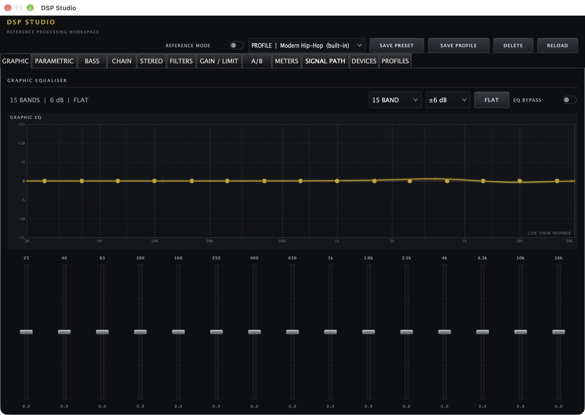
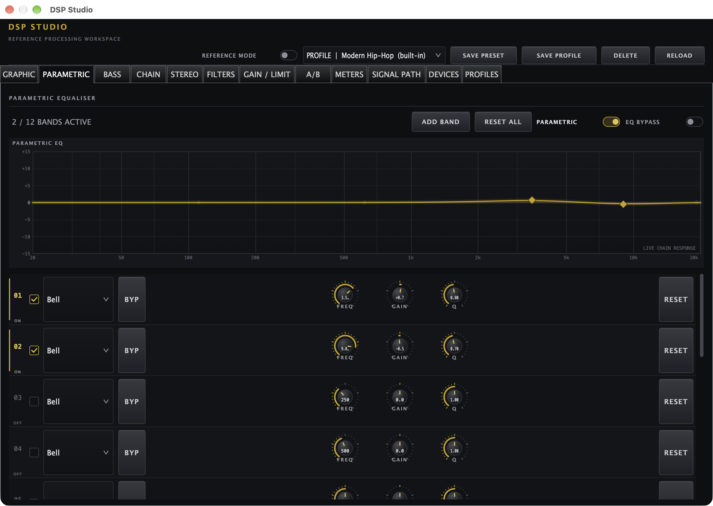
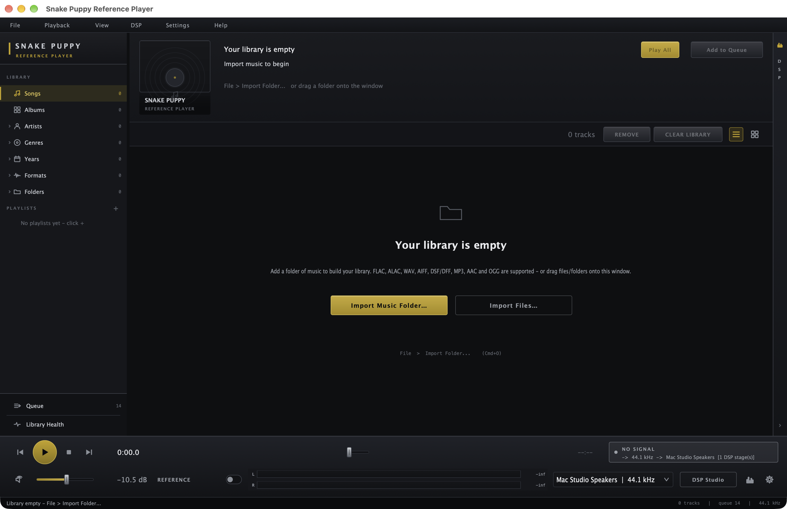

# Snake Puppy Reference Player

[](LICENSE)
[](#requirements)
[](https://juce.com/)

A native macOS audiophile music player built with JUCE/C++17 — a serious local
library, a real 64-bit DSP signal path, measured EQ/bass response, genre-aware
sound profiles, playlists, Core Audio device management and an honest Audio
Signal Path display.

It is a standalone desktop application (Universal-ready arm64 build, Core Audio),
not a web wrapper. Every visible control is connected to real code; every
processing stage is reflected in the signal-path display.

---


## Highlights

- **Real playback engine** — WAV, AIFF, FLAC (16/24-bit, 44.1–192 kHz), ALAC,
  AAC, MP3, OGG Vorbis, and native **DSD64/128/256** (DSF/DFF) decoded to PCM
  with a multistage decimator. Dedicated decode thread, lock-free ring buffer,
  gapless queue playback, memory playback, TPDF dither, high-quality resampling,
  native sample-rate switching, adjustable buffer, hot-plug recovery.
- **64-bit DSP chain** — 15/31-band graphic EQ (−6…+6 dB, extended ±12),
  12-band parametric EQ (bell, low/high shelf, HP/LP, notch, band-pass,
  all-pass, per-band bypass), dedicated bass management (80 Hz low shelf with
  adjustable frequency/Q/slope plus sub-bass, mid-bass and punch bands),
  stereo width with mono safeguard, headphone crossfeed, balance, HP/LP filters,
  convolution with impulse responses, ReplayGain, preamp with **Auto Headroom**,
  lookahead true-peak limiter, user-orderable chain and global bypass.
- **Genre Intelligence** — 11 editable starter profiles (Modern Hip-Hop,
  Old-School Hip-Hop, Classic R&B, Modern R&B, Soul, Classic Funk, Jazz, Rock,
  Pop, Electronic, Flat/Reference). Manual, Automatic (metadata) and
  Intelligent (metadata + measured audio analysis) modes; every automatic
  decision explains itself. Per-song and per-album overrides, plus
  **Learn My Preference** for genre/album/song. Settings survive restarts and
  are transitioned smoothly between tracks.
- **Reference Mode** — one click bypasses all signal-altering DSP, sets unity
  volume, disables ReplayGain and asks the device for the file's native rate.
- **Real metering** — stereo peak, true peak, RMS, LUFS momentary/short-term/
  integrated, loudness range, correlation, crest factor, clipping, input-vs-
  output comparison, FFT spectrum, spectrogram and bass-energy visualisation,
  all computed off the audio thread from real samples.
- **Library** — multiple folder locations (remembered after restart), recursive
  imports, drag-and-drop, folder watching, instant search/filter, browsable by
  artist/album/genre/year/format/folder, embedded artwork, metadata editing
  without touching audio samples, duplicate detection, missing-file handling,
  library health report.
- **Library removal without Settings** — the browser toolbar has **REMOVE** for
  the selected track(s) and **CLEAR LIBRARY** for the whole browser (both ask
  for confirmation; files on disk are never deleted). Delete/Backspace on a
  selection removes it too.
- **Playlists** — internal playlists, smart playlists (metadata rules with
  sort/limit), M3U/M3U8/PLS import and export, drag reordering, queue with
  persistence. Playlist edits never rescan the library.
- **Network output** — the embedded HTTP media server starts automatically at
  launch. `http://<mac-ip>:49800/` is a phone-friendly **library player**: it
  lists the library with search and plays tracks over HTTP with real queue
  behaviour: auto-advance to the next track, previous/next, play/pause and a
  queue position. Hi-res sources are converted on first play to 16-bit/44.1 kHz
  WAV (cached) so phone browsers that cannot decode FLAC/DSD still play;
  `/health` is JSON status, and `/media?f=...` is restricted to the library.
  Generate a QR code for your own LAN address with the snippet in
  [docs/network/README.md](docs/network/README.md). UPnP/DLNA MediaRenderer discovery (SSDP), AVTransport
  control (SOAP) and an embedded HTTP media server with byte-range support. The
  Network panel has a manual **Renderer host** field (enter your Pi's LAN
  address; the placeholder is generic) plus PROBE HOST, which unicast-probes that
  host or a pasted device-description URL; DISCOVER also probes it. Includes a
  built-in mock-renderer self-test. **Direct Raspberry Pi / K11 output**: the
  Network panel can render the current track through the local DSP chain and
  stream it as S32_LE PCM over SSH to the PiBridge receiver (`~/hqdac`) on the
  Pi, which drives the USB DAC (verified with a FiiO K11 R2R). Like PiBridge,
  every stream is upsampled to the K11's maximum exact-multiple rate - 352.8 kHz
  for the 44.1 kHz family, 384 kHz for the 48 kHz family - so the DAC never
  shows the source rate. This keeps EQ, bass, limiter and volume in the path,
  unlike DLNA. The K11 is single-tenant,
  so quit HQPlayer/NAA before using it. Honest capability reporting:
  unsupported transports are labelled as such, and a host with no UPnP renderer
  is reported as such instead of pretending to connect.
- **Device profiles** — separate DSP settings per output device; automatic
  device detection and Core Audio capability reporting; optional exclusive
  (hog) mode.

## Screenshots

| | |
|---|---|
|  |  |
| DSP Studio: 15-band graphic EQ, live chain response, presets/profiles | Parametric EQ: 12 bands, bell/shelf/HP/LP, per-band bypass |



Screenshots use generated/neutral UI state only; no third-party album artwork or
personal library metadata is published. See
[docs/screenshots/README.md](docs/screenshots/README.md).

## Requirements

- macOS 13 Ventura or newer (built and verified on macOS 26.2, Apple Silicon;
  the CMake project also supports a universal arm64 + x86_64 build).
- Xcode Command Line Tools + Xcode (for the macOS SDK), CMake ≥ 3.22.
- No external audio libraries: JUCE is vendored under `JUCE/`.

## Build and run

```bash
cd snake-puppy-reference-player
./scripts/build.sh                 # native arm64 Release build
open "build/SnakePuppyReferencePlayer_artefacts/Release/Snake Puppy Reference Player.app"
```

Full instructions, universal builds, tests and packaging: see **[BUILD.md](BUILD.md)**.

## First run

1. Launch the app.
2. **File → Import Folder…** and pick a music folder (nested folders are scanned
   recursively). You can also drag files or folders onto the window.
3. Double-click any track to play immediately.
4. The right rail gives instant access to the **BASS** control, the EQ curve and
   the profile modes. **DSP Studio** opens the full processing workspace.
5. Choose your DAC/interface in the output selector; the signal-path badge shows
   the real format chain and whether processing is active.

Library locations, playlists, EQ choices, device profiles, window layout and
keyboard shortcuts are persisted under
`~/Library/Application Support/Snake Puppy Reference Player/`.

## Default keyboard shortcuts

| Action | Keys |
|---|---|
| Play / Pause | Space |
| Stop | ⌘. |
| Next / Previous track | ⌘→ / ⌘← |
| Seek ±5 s / ±30 s | ← / → , ⇧⌘← / ⇧⌘→ |
| Volume up / down | ↑ / ↓ |
| Mute | ⇧M |
| Bypass EQ | E |
| Reference Mode | ⇧R |
| Cycle EQ mode | ⇧E |
| Bass +0.5 / −0.5 dB | ] / [ |
| Show Songs / Playlists / Queue / Health | ⌘1 / ⌘2 / ⌘3 / ⌘4 |
| DSP Studio | ⌘D |
| Settings | ⌘, |
| Search | ⌘F |
| Add selection to queue | ⇧⌘↩ |
| Clear queue | ⇧⌘⌫ |
| Rating 1–5 stars | ⌥1 … ⌥5 |

Shortcuts are fully configurable in **Settings → Shortcuts** and take effect
immediately. They are delivered by an application-level key monitor, so Space
and the transport keys work no matter which library view (or table) has focus;
typing in search/metadata fields is left alone.

## Data locations

| What | Where |
|---|---|
| Library database | `~/Library/Application Support/Snake Puppy Reference Player/library.db` |
| Settings, shortcuts, layout | `.../settings.xml` |
| Artwork cache | `.../artwork/` |
| Playlists/presets | `.../playlists/`, `.../presets/` |
| Log | `.../snake-puppy.log` |

Uninstalling is safe: delete the app and that folder.

## Testing

```bash
brew install ffmpeg          # test fixtures only
./scripts/make-fixtures.sh
./scripts/test.sh
```

The suite is a headless JUCE console app; it writes a JUnit report to
`build/reports/tests.xml`. A GitHub Actions workflow is provided as
[docs/ci.yml](docs/ci.yml); copy it to `.github/workflows/ci.yml` (a token with
`workflow` scope, or the GitHub web UI, is required to commit workflow files).

## Verification, limitations, and design notes

- **[TEST_REPORT.md](TEST_REPORT.md)** — measured verification results, the
  161-test automated suite and the manual checklist.
- **[LIMITATIONS.md](LIMITATIONS.md)** — precise, honest capability boundaries
  (bit-perfect conditions, DSD→PCM, network output semantics, unsupported
  transports).
- **[docs/ARCHITECTURE.md](docs/ARCHITECTURE.md)** — module map and threading
  model.

## Project layout

```
Source/Core       value types, DSP parameter model, settings, AppContext coordinator
Source/Audio      decoders, playback engine, Core Audio device management
Source/DSP        biquads, EQ, bass, limiter, stereo tools, analyzers, resampler
Source/Library    SQLite library, scanner/watcher, tags & artwork, health
Source/Playlist   manual/smart playlists, M3U/M3U8/PLS codec, resolver
Source/Profile    genre profiles, intelligent selection, learning, track analysis
Source/Network    UPnP/DLNA control point + HTTP media server + self-test
Source/UI         main window, browsers, transport, DSP studio, meters, settings
Tests/            headless test suite (161 tests) + audio fixtures generator
```

Snake Puppy Reference Player is an independent project: it does not share code,
identifiers, settings or data with any other audio application.

## License

This project is licensed under the **GNU Affero General Public License v3.0**
(AGPL-3.0) — see [LICENSE](LICENSE). That matches the open-source JUCE 8 licence
option; commercial distribution with a JUCE commercial licence is a separate
arrangement. See [THIRD_PARTY_NOTICES.md](THIRD_PARTY_NOTICES.md) for JUCE,
SQLite and test-tool notices.

Contributions are welcome — read [CONTRIBUTING.md](CONTRIBUTING.md) first.
